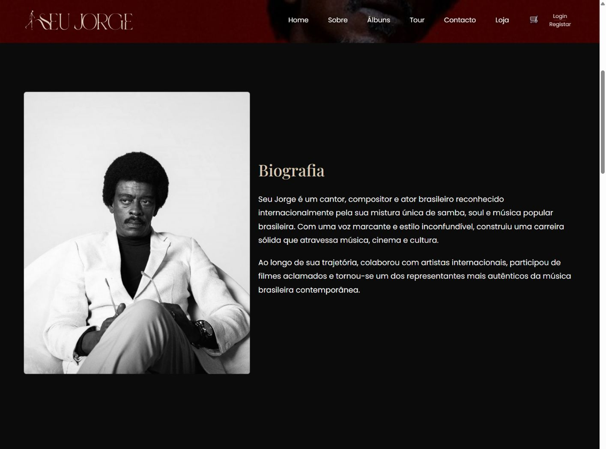
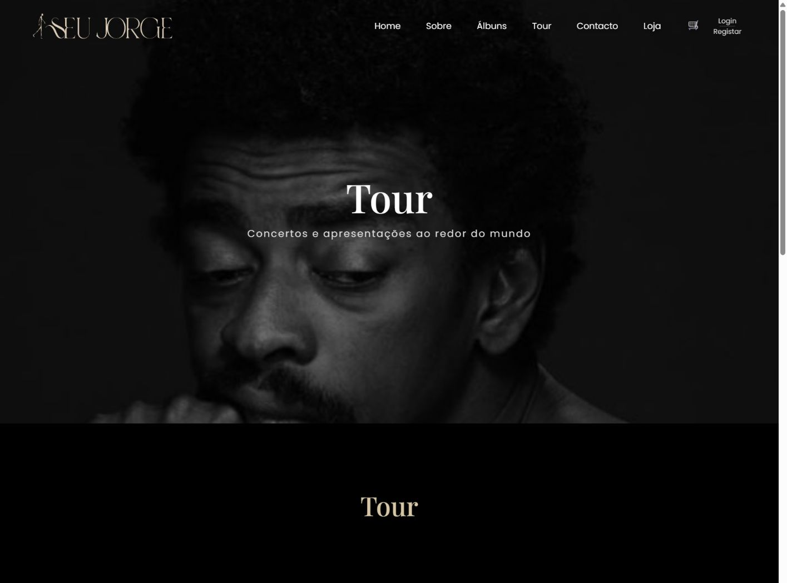
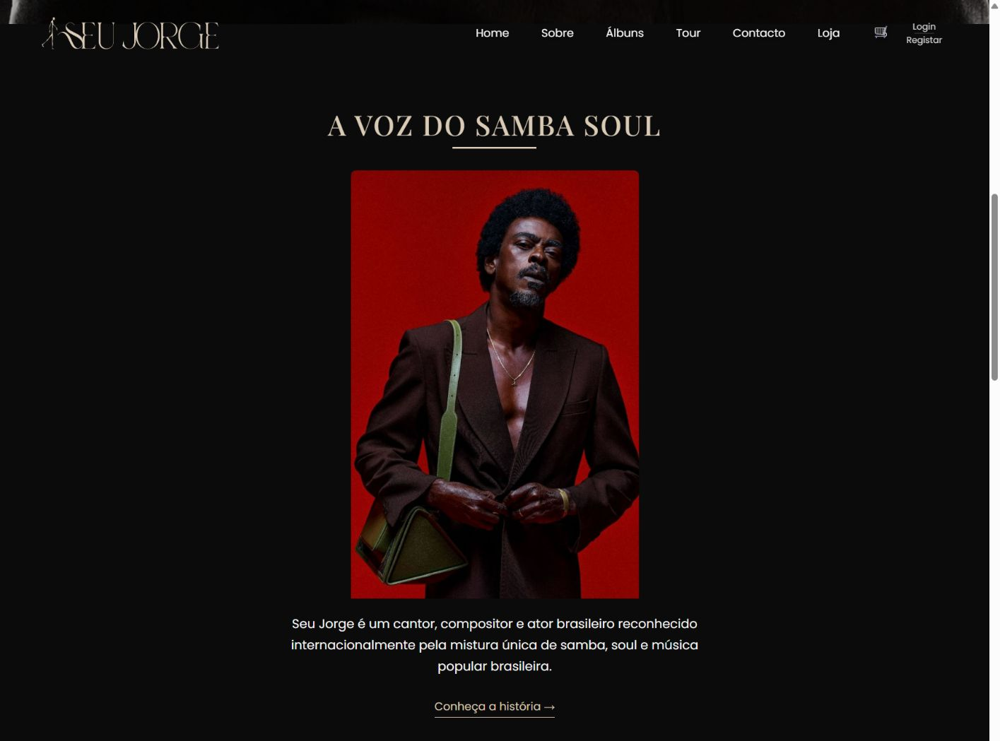

# Seu Jorge — Website artístico & e-commerce

Projeto académico de desenvolvimento web dedicado ao artista **Seu Jorge**, criado para explorar a evolução de um website visual em HTML para uma aplicação dinâmica em PHP com base de dados e funcionalidades de e-commerce.

## Capturas reais

Capturas reais das páginas públicas da aplicação, em desktop e mobile. As imagens preservam a interface original do projeto.

### Página inicial

Slide “Seu Jorge — A voz do samba soul”, com identidade visual, navegação e acesso à discografia.

<table>
<tr><th>Desktop</th><th>Mobile</th></tr>
<tr>
<td width="70%" valign="top"></td>
<td width="30%" valign="top"></td>
</tr>
</table>

### Sobre e biografia

Apresentação do artista, fotografia e organização editorial da biografia.

<table>
<tr><th>Desktop</th><th>Mobile</th></tr>
<tr>
<td width="70%" valign="top"></td>
<td width="30%" valign="top"></td>
</tr>
</table>

### Tour

Página de apresentações do projeto académico. As datas mostradas pertencem à demonstração e não são uma agenda verificada de concertos.

<table>
<tr><th>Desktop</th><th>Mobile</th></tr>
<tr>
<td width="70%" valign="top"></td>
<td width="30%" valign="top"></td>
</tr>
</table>

### Apresentação do artista

Retrato completo com fundo vermelho, descrição e ligação “Conheça a história”. A cor é um efeito de interação já existente no website.

<table>
<tr><th>Desktop</th><th>Mobile</th></tr>
<tr>
<td width="70%" valign="top"></td>
<td width="30%" valign="top"></td>
</tr>
</table>

> Esta galeria documenta as páginas públicas observadas. As áreas de loja, carrinho e administração descritas neste README não foram validadas nesta sessão de capturas.

## Objetivo

O projeto começou com foco em front-end, identidade visual e organização de conteúdo. Ao longo da evolução, passou a integrar autenticação, loja online, carrinho, checkout, área de utilizador e painel administrativo.

## Funcionalidades principais

- Website responsivo com páginas de biografia, música, cinema e tour
- Autenticação e registo de utilizadores
- Loja online e catálogo de produtos
- Carrinho de compras
- Checkout
- Área de perfil do utilizador
- Painel administrativo
- Gestão de produtos, utilizadores e encomendas
- Upload de imagens de produtos
- Estados de encomenda e guia de entrega
- Interações em JavaScript/AJAX
- Validação de formulários

## Tecnologias

`PHP` · `MySQL` · `JavaScript` · `HTML5` · `CSS3` · `Bootstrap` · `AJAX`

## Segurança e boas práticas

- `password_hash` e `password_verify`
- Prepared statements
- Sessões PHP
- Controlo de acesso por função
- Validação de formulários
- Estrutura reutilizável com includes

## Instalação local

1. Copiar a pasta para `C:\xampp\htdocs\`.
2. Iniciar Apache e MySQL no XAMPP.
3. Criar a base de dados `seu_jorge_store`.
4. Importar `database/seu_jorge_store.sql`.
5. Confirmar a porta MySQL em `config/database.php`.
6. Abrir `index.php` através do `localhost`.

### Conta administrativa de demonstração

- Utilizador: `admin`
- Palavra-passe: `admin123`

> Credenciais apenas para demonstração local do projeto académico.

## Estrutura do projeto

- `admin/` — painel e gestão administrativa
- `actions/` — ações PHP e operações AJAX
- `config/` — ligação à base de dados
- `database/` — export MySQL
- `includes/` — componentes reutilizáveis
- `css/` — estilos
- `js/` — JavaScript e AJAX
- `picture/` — recursos visuais usados no website
- `uploads/products/` — uploads gerados pela administração
- `original-html/` — versão inicial em HTML, mantida para mostrar a evolução do projeto

## Evolução demonstrada

Um dos objetivos do projeto foi mostrar a passagem de uma estrutura estática para uma aplicação dinâmica, com lógica de back-end, persistência em MySQL e administração de conteúdo.

## Aviso

Projeto académico e não oficial, desenvolvido exclusivamente para fins educativos e de portefólio. Nomes, imagens e referências ao artista pertencem aos respetivos titulares e não representam associação, patrocínio ou aprovação oficial.
